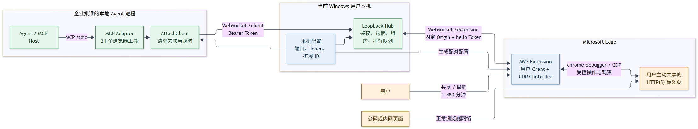
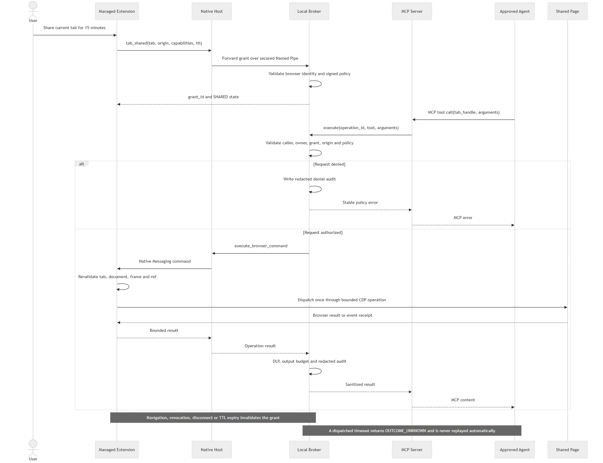

# Enterprise Browser MCP 技术设计

文档状态：Draft v0.1
设计日期：2026-10-22
目标平台：Windows 11 企业工作机、Microsoft Edge Stable
项目代号：Enterprise Browser MCP（EBMCP，正式名称待定）

## 1. 文档目的

本文定义一个可直接部署到企业工作机、允许 Agent 在受管 Edge 中读取和操作用户明确授权页面的 MCP 服务。本文是后续开发、威胁建模、安全评审、测试验收和部署评审的共同基线。

本文不是对 BrowserAttach 的简单重命名。上游项目可提供浏览器控制算法和测试参考，但企业版必须重建本机传输、身份、授权、策略、审计和发布链。

## 2. 设计结论

核心决策如下：

1. 扩展与本机程序使用 Edge Native Messaging，不使用 localhost HTTP/WebSocket。
2. 本机 Broker 是唯一授权点；MCP Server 和扩展均不能自行放宽策略。
3. MCP 只看到用户主动共享的标签，不枚举整个浏览器配置。
4. 授权绑定用户、调用方、浏览器实例、标签、顶层 origin、工具集合和过期时间。
5. 默认能力不包含任意 JavaScript、网络正文捕获、任意文件上传或使用登录态的任意 URL 抓取。
6. 页面输出在返回 MCP 客户端前经过最小化和 DLP；页面内容永远不是授权依据。
7. 所有生产制品从固定源码和依赖构建、签名并通过内部渠道部署，运行时不访问公网包仓库。
8. 页面正文、截图和表单值默认不落盘；审计只记录经过脱敏的元数据。

当前文档的默认假设是“Windows + Edge + 单机本地 Broker”。Chrome 和其他操作系统属于后续兼容工作，不进入首个生产版本。

当前仓库中的 v0.1 是阶段 B 的只读实现，只开放页面读取和同源文档提取。阶段 C
将按本设计加入受控的点击、输入、滚动、按键和同源导航；写操作不会通过通用脚本执行，
必须经过工具白名单、策略判断、用户授权、审计和防重放控制。

## 3. 目标与非目标

### 3.1 目标

- 在员工受管工作机本地提供标准 MCP stdio 服务。
- 操作员工已经打开且主动共享的 Edge HTTP(S) 标签。
- 支持可观察、可控、可撤销、不会自动重放的页面交互。
- 在模型之外实施最小权限、域名限制、用户同意、DLP 和审计。
- 支持 Intune/GPO、内部代码签名、离线运行、灰度和紧急停用。
- 允许后续按业务策略增加受限能力，而不修改信任边界。

### 3.2 非目标

- 不启动或管理独立浏览器。
- 不接管未共享标签、InPrivate 窗口、浏览器内部页面或其他用户会话。
- 不提供通用 CDP 透传。
- 不提供任意 JavaScript 求值。
- 不绕过网站身份验证、CSP、MFA、数据权限或企业代理。
- 不保证网页业务操作成功；只报告可验证的事件派发和页面观察。
- 不抵御已取得管理员/内核权限、可注入 Edge 或可替换企业签名制品的攻击者。

## 4. 威胁模型

### 4.1 需要防护的威胁

| 威胁主体 | 典型行为 | 设计控制 |
|---|---|---|
| 恶意网页 | 提示注入、诱导上传、跨域 iframe 窃取 | 页面内容不参与授权；工具/域名策略；iframe 独立 origin 校验 |
| 未批准的本机进程 | 冒充 Hub、连接 Broker、窃取会话 | Native Messaging；命名管道 ACL；进程 SID、签名、路径和父进程校验 |
| 另一登录用户 | 抢占端口、读取其他用户浏览器 | 无 TCP 端口；每用户命名管道和状态分区 |
| 被入侵的上游包 | `@latest` 或依赖更新执行恶意代码 | 内部源码镜像、固定摘要、SBOM、签名制品、无运行时下载 |
| 失控或被注入的 Agent | 越权读页、重复提交、批量外带 | 用户共享、短期 grant、策略引擎、DLP、速率限制、不自动重放 |
| 操作失误 | 错误标签、导航后继续操作、重复点击 | 标签/文档身份绑定、origin 变化撤销、串行队列、unknown 状态 |

### 4.2 剩余风险

- 用户授权读取的页面内容可能被所选 MCP 宿主或模型处理；是否允许云模型必须由企业数据政策决定。
- 同一用户上下文已被完全攻陷时，攻击者可能操纵批准的调用方或屏幕交互。
- Edge/CDP、操作系统和 MCP SDK 自身漏洞需依赖供应链更新流程修复。
- DLP 只能降低泄露概率，不能证明任意自由文本中不存在敏感信息。

## 5. 总体架构



### 5.1 组件

| 组件 | 运行位置 | 职责 |
|---|---|---|
| MCP Server Adapter | 用户会话，AI 宿主按需启动 | MCP stdio、工具 schema、结果格式转换；不直接访问浏览器 |
| Local Broker | 用户登录后常驻 | 身份验证、grant、策略、标签所有权、队列、DLP、审计、生命周期 |
| Native Host Adapter | Edge 通过 Native Messaging 启动 | Native Messaging 帧与 Broker 协议互转；不做授权决策 |
| Managed Edge Extension | 受管 Edge 配置 | 用户共享 UI、浏览器身份、CDP 操作、页面观察、结果限制 |
| Policy Store | ProgramData + MDM/GPO | 保存企业签名策略、公钥、调用方 allowlist、站点及工具规则 |
| Audit Sink | Windows Event Log/ETW，可转发 SIEM | 保存脱敏安全事件，不保存页面正文 |

### 5.2 进程与权限

- 所有运行时进程使用当前标准用户权限，不要求管理员权限。
- MSI/MSIX 安装和升级需要企业软件分发权限。
- 二进制安装到受 ACL 保护的 `Program Files`；策略放在管理员可写、普通用户只读的 `ProgramData`。
- Broker 为每个 Windows 用户独立运行；不跨 Session 共享浏览器状态。
- Native Host manifest 由企业安装程序写入并限制为唯一生产扩展 ID。
- InPrivate 默认由 Edge 企业策略禁止该扩展运行。

## 6. 关键技术选型

### 6.1 桌面端

建议使用 .NET 8 LTS：

- `Broker.exe`：每用户常驻进程。
- `NativeHost.exe`：Edge Native Messaging Host。
- `McpServer.exe`：标准输入输出 MCP 服务。
- 采用官方或企业批准的 .NET MCP SDK，固定精确版本。
- 使用 `System.IO.Pipes` 创建 Windows Named Pipe，并显式设置 `PipeSecurity`。
- 使用 Windows Authenticode API 验证连接进程、父进程和发布者。
- 发布为 self-contained single-file x64/arm64 制品并进行 Authenticode 签名。

选择 .NET 而不是继续用 Node 承担 Broker 的原因：

- Windows Named Pipe ACL、进程 token、SID、签名和 Event Log 集成更直接；
- 避免在工作机额外安装 Node；
- Native Messaging Host 可以作为普通签名 `.exe` 部署；
- 安全边界代码与网页控制 JavaScript 分离。

### 6.2 扩展端

- TypeScript + Manifest V3，构建为静态 JavaScript。
- 保留必要权限：`debugger`、`tabs`、`storage`、`alarms`、`nativeMessaging`。
- `tabGroups` 仅在确认需要原生可视标记时保留。
- 不声明 `host_permissions`、`externally_connectable` 或 web-accessible scripts。
- 通过 Edge 企业扩展策略强制安装、固定更新源和扩展 ID。
- 生产扩展禁用远程代码、动态 import URL、`eval` 和任意 CDP method。

### 6.3 代码复用策略

可从 BrowserAttach 迁移并重新评审：

- `actionability`、`locator`、`snapshot`、`sessions`；
- `click`、`input`、`scroll`、`wait`、`navigation`；
- 标签级串行队列、ref 生命周期和“不自动重放”测试。

必须重写：

- `background.js` 传输；
- Node Hub、client、setup 和 token 配置；
- MCP 工具注册和权限模型；
- 标签发现/共享流程；
- 审计、策略、DLP 和部署。

首版不迁移：

- 任意 `evaluate`；
- `browser_fetch`；
- 网络 header/body capture；
- 任意路径文件上传；
- 自动发现所有标签；
- 公网 `npx` 配置。

## 7. 本机通信与身份

### 7.1 Edge Extension 到 Native Host

- 扩展调用 `chrome.runtime.connectNative("<company-host-name>")`。
- Edge 根据 Native Host manifest 的 `allowed_origins` 校验生产扩展 ID。
- Native Host manifest 和可执行文件路径由安装程序写入 HKLM，并由管理员 ACL 保护。
- Native Host 验证父进程为受信任路径和签名的 `msedge.exe`。
- Native Messaging 使用标准 4 字节长度前缀 JSON，单消息上限取浏览器和产品限制中的较小值。
- Native Host 不接受命令行提供的扩展 ID、策略路径或任意 Broker 地址。

### 7.2 Adapter 到 Broker

命名管道格式：

```text
\\.\pipe\<Company>.EnterpriseBrowserMcp.<UserSidHash>.v1
```

管道安全描述符只允许：

- 当前用户 SID；
- LocalSystem（仅运维诊断，不默认发起会话）；
- 明确拒绝网络 SID 和其他交互用户。

Broker 接受连接后必须：

1. 取得管道客户端 PID 和 token SID；
2. 打开进程句柄，避免 PID 复用；
3. 验证二进制位于受保护安装目录；
4. 验证 Authenticode 发布者和文件摘要；
5. 对 MCP Adapter 验证其父进程属于策略允许的 AI 宿主；
6. 对 Native Host 验证 Edge 父进程；
7. 创建仅对该连接有效的随机 `connection_id` 和内存会话。

同一用户 SID 不是充分授权条件。未通过二进制和调用方校验的连接必须在解析业务载荷前关闭。

### 7.3 协议 envelope

```json
{
  "version": 1,
  "id": "uuid",
  "type": "execute",
  "connection_id": "opaque",
  "timestamp_ms": 1792660800000,
  "payload": {}
}
```

约束：

- JSON schema 严格校验，拒绝未知消息类型和超限字段。
- 单控制消息最大 1 MiB；图片结果最大 8 MiB。
- `id` 在单连接内唯一；响应必须匹配请求。
- 消息不包含磁盘路径、策略私钥或长期 bearer token。
- 未知版本 fail closed。
- 连接关闭时撤销该连接的 claim；用户共享 grant 是否保留由其 TTL 决定。

### 7.4 消息类型

| 方向 | 类型 | 用途 |
|---|---|---|
| Adapter -> Broker | `hello` | 协议版本和角色声明；身份以 OS 校验结果为准 |
| Extension -> Broker | `browser_connected` | 浏览器实例和扩展版本 |
| Extension -> Broker | `tab_shared` / `tab_revoked` | 用户授权或撤销标签 |
| MCP -> Broker | `list_shared_tabs` / `claim` / `release` | 控制生命周期 |
| MCP -> Broker | `execute` | 执行一个已注册工具 |
| Broker -> Extension | `execute_browser_command` | 发送受策略约束的浏览器命令 |
| Extension -> Broker | `result` / `event` | 返回结果或导航、detach、dialog 事件 |
| Broker -> Adapter | `error` | 稳定错误码和经过脱敏的消息 |

## 8. 用户共享与授权模型

### 8.1 主动共享

扩展默认不把任何标签元数据发送给 Broker。用户在当前标签点击扩展图标后选择：

- 共享时长：用户可配置，开发版允许 1–480 分钟且默认 15 分钟；企业策略可进一步收紧；
- 能力：读取、交互、同域导航；
- 是否允许截图：默认关闭；
- 立即撤销。

共享成功后：

- 扩展显示持续可见的 `SHARED` badge；
- 标签可加入明确命名的原生标签组；
- Broker 获得一个 grant；
- MCP `list_shared_tabs` 只返回仍有效 grant 对应的标签。

### 8.2 Grant

```json
{
  "grant_id": "uuid",
  "user_sid": "S-1-...",
  "browser_instance_id": "opaque",
  "tab_id": 123,
  "top_origin": "https://portal.example.com",
  "capabilities": ["read", "interact", "navigate_same_origin"],
  "duration_minutes": 15,
  "created_at": "2026-10-22T13:00:00Z",
  "expires_at": "2026-10-22T13:15:00Z",
  "max_operations": 200,
  "policy_version": "2026.10.22.1"
}
```

Grant 规则：

- 只保存在 Broker 和扩展内存；不落盘恢复。
- 主文档 origin 改变、标签关闭、扩展断开、用户撤销或策略更新时立即失效。
- `tab_handle` 绑定 MCP 连接，不能跨客户端复用。
- 同一标签同一时刻只有一个 MCP owner。
- MCP 断连释放 claim，但不自动延长 grant。
- iframe 必须按自身 origin 重新校验，不继承顶层页面授权。

## 9. 策略模型

策略由企业私钥签名，Broker 内置企业公钥验证。签名失败、过期或 schema 不支持时进入 fail-closed 状态，只允许状态查询和释放。

建议策略结构：

```json
{
  "schema_version": 1,
  "policy_version": "2026.10.22.1",
  "expires_at": "2027-01-31T00:00:00Z",
  "allowed_callers": [
    {
      "publisher": "CN=Company",
      "product": "Approved Agent Host",
      "path": "%ProgramFiles%\\Company\\Agent\\Agent.exe"
    }
  ],
  "origins": [
    {
      "pattern": "https://*.corp.example.com",
      "tools": ["snapshot", "read_text", "click", "fill", "type", "press_key", "scroll", "wait"],
      "allow_same_origin_navigation": true,
      "allow_screenshot": false
    }
  ],
  "deny_private_networks_by_default": true,
  "grant_ttl_seconds": 900,
  "max_result_chars": 100000,
  "audit_sink": "windows_event_log"
}
```

匹配规则：

- 只接受 `https`；开发策略可单独允许精确 localhost origin。
- origin 按 scheme、规范化 host 和显式/默认 port 比较。
- 通配符只匹配完整子域后缀，不允许公共后缀通配。
- URL query 和 fragment 不进入策略匹配，也不写入审计。
- 重定向、history 导航和 SPA origin 变化后重新授权。
- IP literal、loopback、链路本地、RFC1918、云元数据地址默认拒绝，必须精确授权。
- OOPIF/cross-origin iframe 单独匹配策略；不允许时从快照中省略且不可交互。
- 策略不能由 MCP 参数、网页内容或扩展页面动态放宽。

## 10. MCP 工具面

### 10.1 首版工具

| 工具 | 所需 capability | 说明 |
|---|---|---|
| `browser_list_shared_tabs` | 无 | 仅返回当前用户已共享标签的最小元数据 |
| `browser_claim_tab` | grant | 获取连接级 `tab_handle` |
| `browser_release_tab` | owner | 释放控制 |
| `browser_snapshot` | read | 受限 AX 快照，密码值和未授权 frame 被移除 |
| `browser_read_text` | read | 读取可见文本或指定字段，结果受 DLP 和预算限制 |
| `browser_click` | interact | 原生点击；准备可重试，派发后不重放 |
| `browser_fill` | interact | 填充普通输入，不自动提交 |
| `browser_type` | interact | 原生逐字符输入 |
| `browser_press_key` | interact | 受支持按键集合 |
| `browser_scroll` | interact | 有界滚动 |
| `browser_wait` | read | 有界只读等待 |
| `browser_navigate` | navigate | 默认仅同 origin；每次最终 origin 校验 |

### 10.2 默认不提供

- `evaluate`；
- 通用 CDP；
- `fetch` 或临时登录态标签抓取；
- console/network body；
- 文件上传；
- 打开/关闭任意标签；
- cookie/storage 读取；
- 跨域导航；
- 后台脚本、循环和计划任务。

未来增加高风险工具必须单独写 ADR、威胁模型、策略字段和审批 UX，不能仅增加 MCP schema。

## 11. 请求执行流程



每次工具调用经过以下固定阶段：

1. MCP schema 严格校验。
2. Broker 校验连接身份、调用方和版本。
3. 校验 `tab_handle`、owner、grant、TTL、操作次数和当前 top origin。
4. 计算风险类别并匹配企业策略。
5. 对读取参数应用输入最小化，对写操作建立一次性 `operation_id`。
6. 进入标签串行队列。
7. 扩展在派发前重新确认文档、frame、ref 身份和 origin。
8. 动作派发一次；超时或断连后返回 `OUTCOME_UNKNOWN`，不得自动重放。
9. 结果先在扩展限量，再由 Broker 做 DLP、字段删除和总预算限制。
10. 写入脱敏审计事件后返回 MCP。

### 11.1 操作状态

```text
RECEIVED -> AUTHORIZED -> QUEUED -> PREPARING -> DISPATCHED -> COMPLETED
                                              \-> REJECTED
                                              \-> OUTCOME_UNKNOWN
```

- `PREPARING` 前的失败保证未派发。
- `DISPATCHED` 后没有自动重试。
- `OUTCOME_UNKNOWN` 必须提示重新观察，由调用方或用户决定下一步。
- Broker 保存短期 `operation_id` 去重表，重复请求返回原状态，不再次派发。

## 12. 页面内容和 DLP

### 12.1 输入最小化

- AX snapshot 默认只返回交互节点、必要祖先和有限文本预览。
- `<input type=password>`、ARIA password、autocomplete credential 字段永不返回 value。
- URL 默认只返回 origin + path，删除 query 和 fragment；策略可进一步隐藏 path。
- screenshot 默认关闭；开启时需要独立 capability 和结果大小限制。
- console、network headers、body 和 local/session storage 不进入首版。

### 12.2 输出处理

Broker 以结构化字段执行：

- 秘钥、token、cookie、Authorization、身份证、银行卡等企业 DLP 规则；
- email、手机号等按策略遮盖；
- 单字段和总结果长度限制；
- 结果超限显式标记，不静默返回完整数据；
- 不把页面文本写入错误日志、Event Log 或 crash telemetry。

自由文本脱敏不能保证完整，因此敏感系统应优先使用字段 allowlist 和专用工具，而不是扩大通用 `read_text`。

### 12.3 内存与崩溃

- 页面结果只在有界内存中保存，TTL 到期或连接关闭时删除引用。
- 禁止创建包含进程完整内存的用户态 crash dump。
- 生产日志关闭 request/response body。
- screenshot 使用后立即释放，不写临时文件。

## 13. 审计

建议事件：

| 事件 | 关键字段 |
|---|---|
| `client_connected` | user SID hash、调用方产品、签名状态、版本 |
| `tab_shared` / `tab_revoked` | grant ID、origin、capability、TTL、原因 |
| `tab_claimed` / `tab_released` | client ID、tab session ID |
| `operation_authorized` | operation ID、工具、origin、policy version |
| `operation_completed` | 状态、耗时、输入/输出字节数、是否截断 |
| `operation_denied` | 稳定原因码、策略规则 ID |
| `security_validation_failed` | 对端角色、验证阶段、原因码 |
| `kill_switch_applied` | 策略版本、时间 |

不得记录：

- 页面正文、表单值、截图；
- 完整 URL query/fragment；
- token、cookie、文件内容；
- MCP prompt 或模型回复；
- Native Messaging 原始载荷。

## 14. 错误模型

稳定错误码示例：

| 错误码 | 含义 |
|---|---|
| `CLIENT_NOT_ALLOWED` | 调用方进程不在 allowlist |
| `POLICY_UNAVAILABLE` | 策略缺失、签名无效或过期 |
| `TAB_NOT_SHARED` | 用户未共享或 grant 已撤销 |
| `ORIGIN_NOT_ALLOWED` | 当前或目标 origin 不允许 |
| `CAPABILITY_NOT_GRANTED` | grant 不包含工具能力 |
| `TAB_ALREADY_OWNED` | 标签由其他 MCP 连接控制 |
| `STALE_HANDLE` | 连接、文档或 ref 已变化 |
| `INPUT_NOT_DISPATCHED` | 准备失败，确认未派发 |
| `OUTCOME_UNKNOWN` | 已派发但结果无法确认 |
| `RESULT_REDACTED` | DLP 删除了全部可返回内容 |
| `VERSION_MISMATCH` | 组件协议或制品版本不兼容 |

错误消息不得拼接页面正文、敏感 URL 或底层异常堆栈。详细异常只进入本地受限诊断通道，并经过脱敏。

## 15. 配置、部署与升级

### 15.1 安装

企业安装包包含：

- 三个 Authenticode 签名桌面可执行文件；
- 生产 Edge 扩展及固定扩展 ID；
- Native Host manifest；
- 企业策略验证公钥；
- Windows Event Log source；
- 受管启动项和卸载逻辑。

Edge 策略至少配置：

- `ExtensionInstallForcelist`；
- 固定内部更新 URL；
- `NativeMessagingAllowlist`；
- 禁止用户修改/移除生产扩展；
- 禁止 InPrivate；
- 根据企业要求阻止其他同类调试扩展。

### 15.2 更新

- 制品只从内部软件分发系统获取。
- manifest 包含版本、SHA-256、签名和最低兼容协议。
- Broker、Native Host、MCP Server 和扩展使用兼容矩阵。
- 不兼容版本 fail closed，但保留释放/撤销能力。
- 支持分组灰度、自动回滚和全局 kill switch。
- kill switch 可禁止所有新 grant，并立即释放现有 claim。

## 16. 建议代码结构

```text
enterprise-browser-mcp/
  src/
    Broker/
    NativeHost/
    McpServer/
    Protocol/
    Policy/
    Audit/
    Dlp/
  extension/
    src/
      background/
      controller/
      consent/
      protocol/
    manifest.json
  contracts/
    broker-envelope.schema.json
    policy.schema.json
    audit-event.schema.json
  tests/
    unit/
    integration/
    adversarial/
    browser-live/
  packaging/
    windows/
    edge-policy/
  docs/
    adr/
    threat-model/
    operations/
```

协议 schema 是跨 .NET/TypeScript 的唯一事实来源，并在 CI 中生成类型或验证兼容性。

## 17. 测试策略

### 17.1 单元测试

- 策略 origin 匹配、通配符、IP 范围和过期行为；
- grant、claim、TTL、导航撤销；
- 请求状态机和不自动重放；
- DLP、预算、密码字段删除；
- 消息 schema 和版本兼容；
- BrowserAttach 迁移模块的定位、ref、OOPIF、输入回执。

### 17.2 集成测试

- MCP stdio -> Broker -> Native Host 模拟器 -> 扩展控制器；
- 多 MCP 客户端争用同一标签；
- Edge 重启、扩展重载、Broker 崩溃和断连清理；
- 策略热更新、kill switch、版本不兼容；
- Event Log 中不出现正文或 secret。

### 17.3 对抗测试

- 非 Edge 进程启动 Native Host；
- 未签名/错误父进程连接命名管道；
- 另一 Windows 用户连接；
- PID 复用、符号链接/安装目录替换；
- 恶意网页提示注入和超大 DOM；
- 导航、重定向、DNS/private IP、cross-origin iframe 绕过；
- 消息重放、乱序、重复 ID、超限 payload；
- 动作派发后超时，确认绝不重复提交；
- DLP 绕过样本和截图泄露。

### 17.4 生产准入

- 0 个未关闭 P0/P1 安全问题；
- 第三方安全评审通过；
- Windows 11 + Edge 当前版及 N-1 live test 通过；
- 受管安装、升级、回滚、卸载和 kill switch 演练通过；
- 云模型场景完成数据合规评审；
- 运维 runbook 和事件响应流程完成。

## 18. 非功能指标

| 指标 | 首版目标 |
|---|---|
| 离线可用 | 除 MCP 宿主自身外不依赖外部服务 |
| Broker 启动 | 登录后 3 秒内可用 |
| Broker 附加延迟 | 普通调用 P95 小于 50 ms，不含浏览器执行 |
| 断连清理 | 2 秒内开始释放，10 秒内完成或记录异常 |
| 控制消息 | 最大 1 MiB |
| 图片结果 | 最大 8 MiB，默认禁用 |
| 文本结果 | 默认 24k 字符，策略上限 100k |
| 并发 | 每标签串行；每用户最多 8 个共享标签 |
| 数据持久化 | 页面正文 0；审计仅元数据 |

## 19. 开发阶段与退出条件

### 阶段 A：安全骨架

- 建立 .NET solution、扩展工程、schema 和 CI。
- 完成 Broker、Native Host、MCP Adapter 的安全连接。
- 完成调用方身份验证、签名策略、Event Log。

退出条件：未批准进程、另一用户和错误扩展均无法建立业务会话。

### 阶段 B：只读闭环

- 用户共享/撤销 UI；
- list、claim、release、snapshot、read_text；
- origin/frame 策略和 DLP。

退出条件：只读链路可在真实 Edge 工作，且未共享标签元数据不会离开扩展。

### 阶段 C：受控交互

- click、fill、type、press_key、scroll、wait、同域 navigate；
- 串行队列、回执、unknown outcome、不重放。

退出条件：所有写操作通过故障注入测试，没有重复派发。

### 阶段 D：企业部署

- MSI/MSIX、Edge 策略、内部签名、SBOM、灰度、回滚、kill switch；
- SIEM 转发和运维 runbook。

退出条件：通过安全评审和受限试点准入。

### 阶段 E：受限试点

- 仅指定用户、指定工作机、指定站点；
- 观察拒绝率、错误率、性能和审计质量；
- 不在试点阶段增加高风险工具。

退出条件：业务验收、安全复评和数据合规共同批准生产扩大。

## 20. 开发前需要确认的企业决策

以下项目不阻塞安全骨架开发，但必须在只读闭环完成前确定：

1. 正式产品名、代码签名主体和扩展发布渠道。
2. 获准调用 MCP 的 AI 宿主产品、安装路径和签名发布者。
3. 首批允许 origin，以及是否允许企业内网 HTTP。
4. MCP 宿主使用本地模型、企业云模型还是公网模型。
5. grant 默认 TTL、交互能力是否需要逐次确认。
6. DLP 产品/API 和 SIEM 接入方式。
7. 是否需要 screenshot；文件上传应保持禁用还是进入后续专项设计。
8. Windows x64/arm64 支持范围和 Edge 版本基线。

## 21. ADR 摘要

| ADR | 决策 | 状态 |
|---|---|---|
| ADR-001 | Native Messaging 替代 localhost WebSocket | Accepted |
| ADR-002 | 每用户 Broker + Windows Named Pipe | Accepted |
| ADR-003 | .NET 8 桌面端，TypeScript MV3 扩展 | Proposed |
| ADR-004 | 用户主动共享，禁止全标签发现 | Accepted |
| ADR-005 | 首版移除 evaluate/fetch/network body/upload | Accepted |
| ADR-006 | 签名策略 + 模型外强制授权 | Accepted |
| ADR-007 | 页面数据不落盘，审计只存元数据 | Accepted |

本文批准后，正式开发从阶段 A 开始，并首先实现 ADR-001、ADR-002 和 ADR-006 的可测试骨架。
